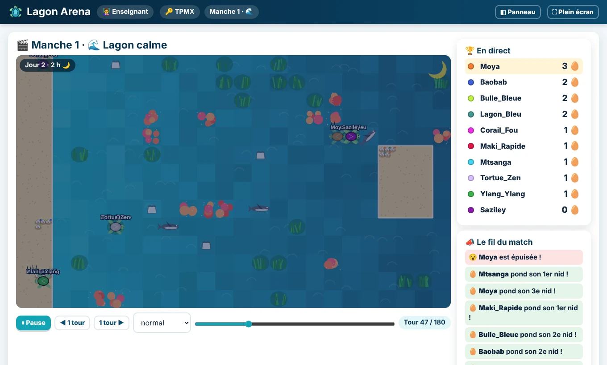

# 🐢 Lagon Arena

**Le chapitre des conditions en Python, transformé en tournoi de tortues marines.** Pour la 1re NSI.

> Vos élèves écrivent le cerveau d'une tortue de mer avec des `if`, des `elif` et des `else`. Elle doit manger, échapper aux requins et pondre la nuit sur la plage. Puis **toutes les tortues de la classe plongent en même temps dans le même lagon**, projeté au tableau. Après le match, chacun revoit ce que sa tortue a « pensé » tour par tour, comprend pourquoi elle s'est fait manger, la corrige… et c'est le rematch.

## 👉 [Essayer maintenant : babash.github.io/lagon-arena](https://babash.github.io/lagon-arena/index.html)

**Gratuit · sans compte · rien à installer · des pseudos, aucune donnée personnelle**



---

## Une séance en trois étapes

1. **Vous** ouvrez l'[espace enseignant](https://babash.github.io/lagon-arena/prof.html) et cliquez sur **Créer une salle** : un code de 4 lettres s'affiche au tableau.
2. **Les élèves** vont sur [le site](https://babash.github.io/lagon-arena/index.html), font le **tutoriel** (15 minutes, aucun prérequis), puis tapent le code et un pseudo.
3. **Vous lancez les manches** : 8 minutes de programmation, le **brawl** projeté (1 minute), 3 minutes de rapport… puis un rematch avec une nouveauté (invasion de plastique, nuits courtes, requins affamés).

| | |
|---|---|
|  **Le tutoriel** : 14 étapes par l'exemple, des exercices vérifiés tout de suite, 4 tortues à réparer. |  **L'écran élève** : un éditeur qui complète les mots (même en français), un bac à sable pour tester. |
|  **Après le brawl** : le match rejoué en suivant sa tortue, ce qu'elle pensait, des conseils qui disent quoi écrire. |  **Au tableau** : podium, résultats du match, classement de la séance. |

Vous voulez d'abord découvrir seul ? Ouvrez l'[espace enseignant en mode démo](https://babash.github.io/lagon-arena/prof.html?demo) et ajoutez des élèves fictifs.

## Ce que les élèves écrivent

```python
def tour():                                   # appelée à chaque tour du match
    if requin_proche() and not sur_plage():   # le premier vrai gagne : la survie d'abord
        fuir()
    elif sur_plage() and est_la_nuit() and energie() >= 6:
        pondre()                              # 1 nid = 1 point
    elif est_la_nuit() and energie() >= 6:
        aller_vers_plage()
    elif algue_ici() and not plastique_ici():
        manger()
    else:
        aller_vers_algue()
```

La tortue fournie au départ sait manger… mais **ne pond jamais** : sans rien changer, c'est zéro. Le besoin de comprendre le code vient avant l'explication. Et comme un match dure 180 tours dans un lagon différent à chaque fois, l'ordre des `elif`, un `and` oublié ou un `not` mal placé **se voient tout de suite**.

## Pour quels usages

| Usage | Comment |
|---|---|
| **Une séance en classe** (≈ 55 min, jusqu'à 30 élèves) | Tutoriel, puis trois manches : programmation, brawl projeté, rapport, rematch. Le déroulé est [prêt à l'emploi](docs/GUIDE-ENSEIGNANT.md#2-le-déroulé-conseillé-dune-séance--55-min). |
| **Un devoir à la maison** | **📚 Créer un devoir** : choisissez la nouveauté, lancez, envoyez le lien aux élèves. Ils programment de chez eux ; vous lancez le brawl quand vous voulez. |
| **Une manche sur plusieurs cours** | ♾️ Temps illimité : chaque élève reprend sa tortue sur n'importe quel ordinateur avec son **code de session**. |
| **En équipes** | 2 à 6 équipes, équilibrées d'après le classement : seul le rang de l'équipe compte, et l'entraide devient une stratégie. |
| **Un lagon sur mesure** | La nouveauté de manche (calme, plastique, tempête…), puis, si vous voulez, le détail : nombre de requins, leur vitesse, le plastique, les heures de nuit, le corail, les algues. |
| **Pour les élèves les plus à l'aise** | Un [tutoriel avancé](https://babash.github.io/lagon-arena/tuto-avance.html) en trois niveaux : 🥈 intermédiaire, 🥇 expert (choisir ses algues), 👥 équipe. |
| **Pour s'entraîner seul** | Le [bac à sable](https://babash.github.io/lagon-arena/eleve.html?libre=1), contre 5 tortues d'entraînement, avec une estimation sur 50 parties. |
| **Le Panthéon** | Les [100 meilleures tortues de tous les temps](https://babash.github.io/lagon-arena/pantheon.html), toutes jugées sur les mêmes 20 lagons ; classement par lycée. Le programme des tortues reste secret. |

## Pourquoi ça marche

- **Un seul concept, et il est nécessaire** : chaque construction (`if`, ordre des `elif`, `and`, `not`, comparaisons) a une raison d'être dans le lagon.
- **Pour tous les niveaux** : du grand débutant (tutoriel par l'exemple, coup de pouce, erreurs expliquées en français) à l'élève expert.
- **L'exécution rendue visible** : « Dans la tête de ta tortue », les conditions vraies s'affichent en vert, les fausses en rouge, à chaque tour.
- **Des retours rapides et utiles** : au bout de quelques secondes dans le bac à sable, de quelques minutes avec le rapport, puis à chaque manche avec le rematch. Et **« Et si… ? »** rejoue exactement le même match avec le code corrigé.
- **Un vrai moment de classe**, qui récompense aussi la **progression** et la **coopération**.

Les principes, les limites (franchement) et un argumentaire pour présenter le jeu à vos collègues : **[docs/PEDAGOGIE.md](docs/PEDAGOGIE.md)**.

## Pour aller plus loin

| Document | Contenu |
|---|---|
| [Guide de l'enseignant](docs/GUIDE-ENSEIGNANT.md) | Le déroulé d'une séance, quoi dire aux élèves, préparer les manches, le devoir, les tutoriels, des conseils pratiques |
| [Règles du jeu](docs/REGLES.md) | Toutes les règles détaillées, les nouveautés de manche, les points, les équipes, **toutes les primitives** |
| [Pédagogie](docs/PEDAGOGIE.md) | Principes de conception, points forts, limites et pistes, pitch en 1 phrase / 30 s / 2 min, questions fréquentes |
| [Architecture](docs/ARCHITECTURE.md) | Pour les curieux et les contributeurs : le moteur, le code, la vérification automatique |

## Feuille de route

Les chantiers en cours (téléphones, rendu graphique, erreurs de logique, galerie des gagnantes, page « Tester », fluidité) sont détaillés dans **[TODO.md](TODO.md)**.

Autres pistes :

- **défier les champions** du Panthéon (top 1 à top 100) sans révéler leur programme : il faudra faire jouer ces matchs par le serveur ;
- **classer une manche sur plusieurs lagons** pour réduire la part de chance d'un seul brawl ;
- une fiche **« de la tortue à Python »** pour réinvestir les conditions hors du jeu ;
- des **tests de bout en bout** dans le dépôt, et un audit d'**accessibilité**.

## Contact

Conçu pour les classes de NSI de l'académie de Mayotte, développé avec [Claude Code](https://claude.com/claude-code).
Une question, une idée, un bug ? [victor.connes@ac-mayotte.fr](mailto:victor.connes@ac-mayotte.fr) ou les [issues GitHub](https://github.com/babash/lagon-arena/issues).

## Licence

Lagon Arena (code, textes, images) est sous licence [**CC BY-SA 4.0**](https://creativecommons.org/licenses/by-sa/4.0/deed.fr) : vous pouvez l'utiliser, le copier, l'adapter et le partager, y compris pour vos classes, à condition de **citer l'auteur** et de **partager vos modifications sous la même licence**. Texte complet : [LICENSE](LICENSE).
