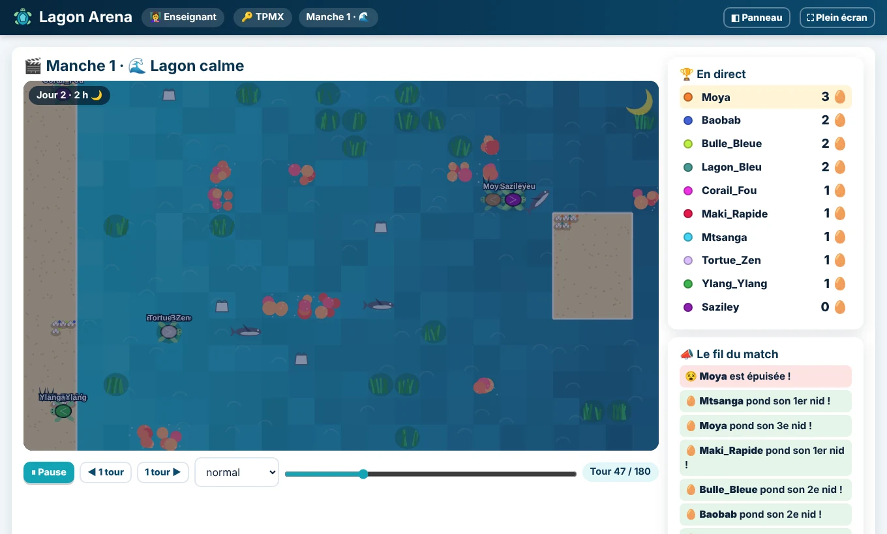
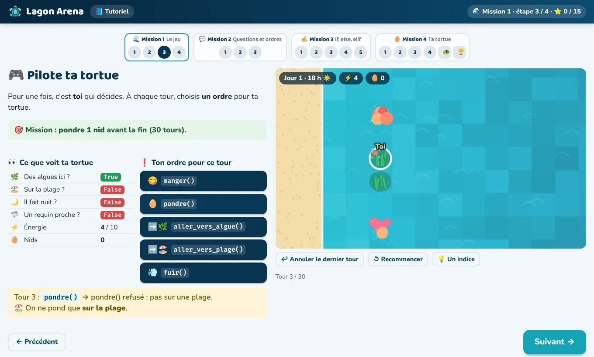
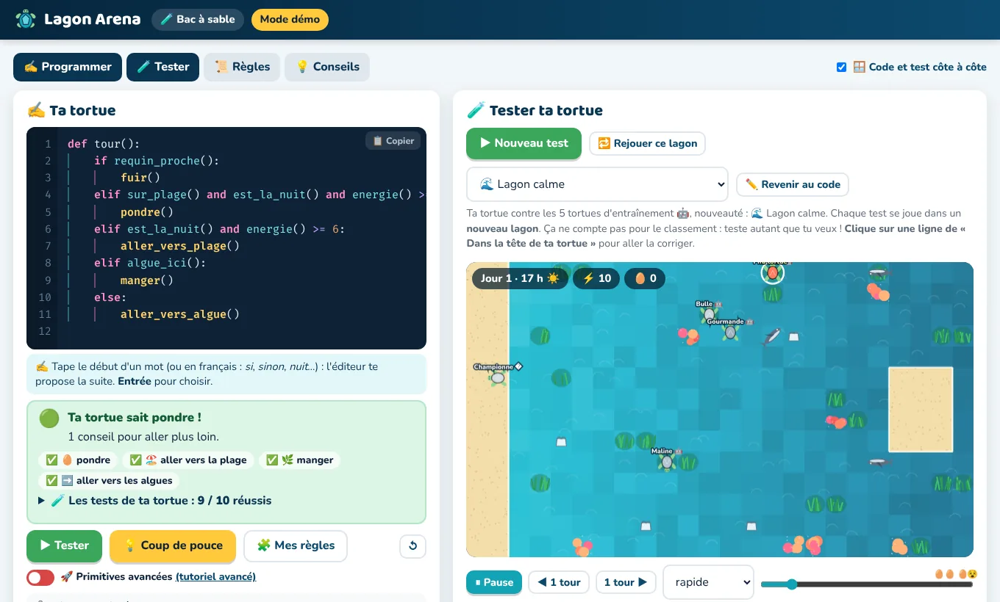
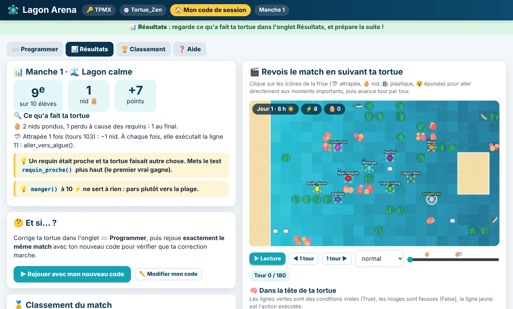
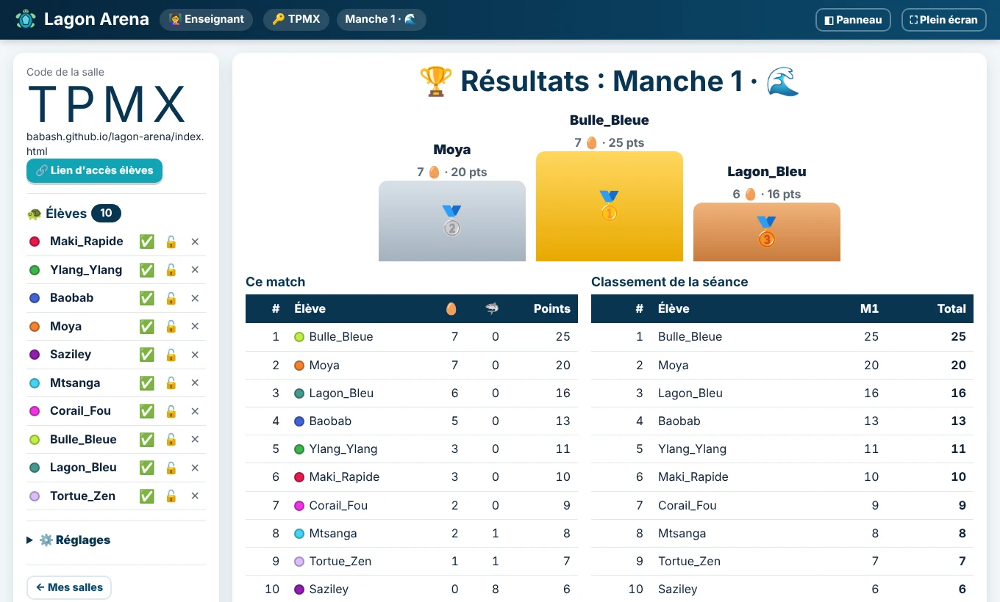

# 🐢 Lagon Arena

**Le chapitre des conditions en Python, transformé en tournoi de tortues marines.** Pour la 1re NSI, et dès la Seconde (SNT).

> Tes élèves écrivent le cerveau d'une tortue de mer avec des `if`, des `elif` et des `else`. Elle doit manger, échapper aux requins et pondre la nuit sur la plage. Puis **toutes les tortues de la classe plongent en même temps dans le même lagon**, projeté au tableau. Après le match, chacun·e revoit ce que sa tortue a « pensé » tour par tour, comprend pourquoi elle s'est fait manger, la corrige… et c'est le rematch.

## 👉 [Essayer maintenant : babash.github.io/lagon-arena](https://babash.github.io/lagon-arena/index.html)

**Gratuit · sans compte · rien à installer.** Enregistrés en ligne : le pseudo, la couleur de la tortue, les programmes envoyés (un par manche) et les scores, sans nom ni adresse électronique ; le Panthéon public affiche le pseudo, l'établissement (donné par l'enseignant·e), la date et la moyenne, jamais le programme.

Lagon Arena fait partie des [Ressources NSI et SNT](https://babash.github.io/Babash-NSI-SNT/), rubrique [NSI Première](https://babash.github.io/Babash-NSI-SNT/nsi-premiere/).



---

## Une séance en trois étapes

1. **Tu** ouvres l'[espace enseignant·e](https://babash.github.io/lagon-arena/prof.html) et cliques sur **Créer une salle** : un code de 4 lettres s'affiche au tableau. C'est lui qui identifie la classe ; tu peux y ajouter le nom de ton établissement, si tu le souhaites.
2. **Les élèves** vont sur [le site](https://babash.github.io/lagon-arena/index.html), suivent leur **parcours en 4 missions** (environ 30 minutes, aucun prérequis : la première se joue sans code), puis tapent le code et un pseudo.
3. **Tu lances les manches** : 8 minutes de programmation, le **brawl** projeté (1 minute), 3 minutes de rapport… puis un rematch avec une nouveauté (invasion de plastique, nuits courtes, requins affamés).

| | |
|---|---|
|  **Le parcours en 4 missions** : piloter sa tortue à la main pour découvrir les règles, écrire ses règles en français, compléter le code avec des listes, puis l'écrire. L'élève repart avec une tortue qui pond. |  **L'écran élève** : ✍️ Programmer (un éditeur qui complète les mots, même en français, et 🧩 Mes règles pour ajouter une règle sans taper), 🧪 Tester (le lagon et la « pensée » côte à côte), 📜 Règles, 💡 Conseils. |
|  **Après le brawl** : le match rejoué en suivant sa tortue, ce qu'elle pensait, des conseils qui disent quoi écrire. |  **Au tableau** : podium, résultats du match, classement de la séance. |

Tu veux d'abord découvrir le jeu seul·e ? Ouvre l'[espace enseignant·e en mode démo](https://babash.github.io/lagon-arena/prof.html?demo) et ajoute des élèves fictif·ve·s.

## Ce que les élèves écrivent

```python
def tour():                                   # appelée à chaque tour du match
    if requin_proche() and not sur_plage():   # le premier vrai gagne : la survie d'abord
        fuir()
    elif sur_plage() and est_la_nuit() and energie() >= 6:
        pondre()                              # 1 nid = 1 point
    elif est_la_nuit() and energie() >= 6:
        aller_vers_plage()
    elif algue_ici() and not plastique_ici():
        manger()
    else:
        aller_vers_algue()
```

La tortue fournie au départ sait manger… mais **ne pond jamais** : sans rien changer, c'est zéro. Le besoin de comprendre le code vient avant l'explication. Et comme un match dure 180 tours dans un lagon différent à chaque fois, l'ordre des `elif`, un `and` oublié ou un `not` mal placé **se voient tout de suite**.

## Pour quels usages

| Usage | Comment |
|---|---|
| **Une séance en classe** (≈ 55 min, toute la classe) | Les missions du parcours, puis trois manches : programmation, brawl projeté, rapport, rematch. Le déroulé est [prêt à l'emploi](docs/GUIDE-ENSEIGNANT.md#2-le-déroulé-conseillé-dune-séance--55-min). |
| **Un devoir à la maison** | **📚 Créer un devoir** : choisis la nouveauté, lance, envoie le lien aux élèves. Ils et elles programment à la maison ; tu lances le brawl quand tu veux. |
| **Une manche sur plusieurs cours** | ♾️ Temps illimité : chaque élève reprend sa tortue sur n'importe quel ordinateur avec son seul **code de session** (8 caractères), sans retaper la salle ni le pseudo. |
| **En équipes** | 2 à 6 équipes, équilibrées d'après le classement : seul le rang de l'équipe compte, et l'entraide devient une stratégie. |
| **Un lagon sur mesure** | La nouveauté de manche (calme, plastique, tempête…), puis, si tu veux, le détail : nombre de requins, leur vitesse, le plastique, les heures de nuit, le corail, les algues. |
| **Pour les élèves les plus à l'aise** | Des [missions avancées](https://babash.github.io/lagon-arena/tuto-avance.html) en trois niveaux : 🥈 intermédiaire, 🥇 expert (choisir ses algues), 👥 équipe. |
| **Pour s'entraîner seul·e** | Le [bac à sable](https://babash.github.io/lagon-arena/eleve.html?libre=1), contre 5 tortues d'entraînement, avec une estimation sur 50 parties. |
| **Voir où chacun·e bloque** | Pendant la programmation, une pastille 🟢 🟠 🔴 🐞 par élève, d'après sa dernière tortue envoyée, et « 🥚 18 tortues sur 25 pondent ». Un clic sur un pseudo montre son code et pourquoi sa tortue ne pond pas (avec un bouton 🙈 Masquer, car l'écran est souvent projeté). |
| **Le Panthéon** | Les [100 meilleures tortues de tous les temps](https://babash.github.io/lagon-arena/pantheon.html), toutes jugées sur les mêmes 20 lagons, affichées avec le pseudo, l'établissement (s'il est renseigné), le score et la date ; classement par établissement. À la fin de chaque manche, la meilleure tortue de la classe y entre toute seule (réglable, ou désactivable). Le programme des tortues reste secret. |

## Pourquoi ça marche

- **Un seul concept, et il est nécessaire** : chaque construction (`if`, ordre des `elif`, `and`, `not`, comparaisons) a une raison d'être dans le lagon.
- **Pour tous les niveaux** : des grand·e·s débutant·e·s de Seconde (un parcours en missions qui commence sans code, les règles en 6 cartes, 🧩 Mes règles, le coup de pouce, les erreurs expliquées en français) aux élèves expert·e·s.
- **L'exécution rendue visible** : « Dans la tête de ta tortue », les conditions vraies s'affichent en vert, les fausses en rouge, à chaque tour.
- **Des retours rapides et utiles** : au bout de quelques secondes dans le bac à sable, de quelques minutes avec le rapport, puis à chaque manche avec le rematch. Et **« Et si… ? »** rejoue exactement le même match avec le code corrigé.
- **Un vrai moment de classe**, qui récompense aussi la **progression** et la **coopération**.

Les principes, les limites (franchement) et un argumentaire pour présenter le jeu à tes collègues : **[docs/PEDAGOGIE.md](docs/PEDAGOGIE.md)**.

## Données des élèves

- **Enregistré en ligne** (Supabase, dans la base commune des applications du site, schéma `lagon`) : pour chaque salle, son code et, si tu le renseignes, ton établissement ; pour chaque élève, un pseudo, une couleur, les programmes envoyés et les scores ; au Panthéon, le pseudo, la date, l'établissement de la salle, la moyenne, le programme et la salle d'où vient la tortue (jamais affichée). Aucun champ pour le nom ni pour l'adresse électronique. Aucune table n'est lisible directement : la page passe par des fonctions qui vérifient le code de la salle, son secret ou le jeton de l'élève.
- **Visible par les autres** : les pseudos et les scores ; les programmes des tortues, par l'enseignant·e de la salle pendant la manche, et par la classe seulement après le brawl ; au Panthéon, le pseudo, l'établissement, la date et la moyenne, jamais le programme ni la classe.
- **Sur l'appareil** : le stockage du navigateur, un jour pour ce qui est à l'élève (codes de session, programme en cours, tutoriels), 60 jours pour ce qui est à toi (tes salles, tes réglages).
- **Pour effacer** : tu peux retirer un·e élève de ta salle ; les séances terminées depuis 7 jours et les salles sans activité depuis 60 jours sont effacées automatiquement ; l'administration du Panthéon peut retirer une tortue.

Le détail : [docs/ARCHITECTURE.md](docs/ARCHITECTURE.md) (§ 7, la base de données) et [docs/GUIDE-ENSEIGNANT.md](docs/GUIDE-ENSEIGNANT.md) (§ 6, le Panthéon).

## Pour aller plus loin

| Document | Contenu |
|---|---|
| [Guide de l'enseignant·e](docs/GUIDE-ENSEIGNANT.md) | Le déroulé d'une séance, quoi dire aux élèves, préparer les manches, le devoir, les tutoriels, des conseils pratiques |
| [Règles du jeu](docs/REGLES.md) | Toutes les règles détaillées, les nouveautés de manche, les points, les équipes, **toutes les primitives** |
| [Pédagogie](docs/PEDAGOGIE.md) | Principes de conception, points forts, limites et pistes, pitch en 1 phrase / 30 s / 2 min, questions fréquentes |
| [Architecture](docs/ARCHITECTURE.md) | Pour les curieux·ses et les contributeur·rice·s : le moteur, le code, la vérification automatique |

## Feuille de route

Les chantiers en cours (téléphones, rendu graphique, galerie des gagnantes, écran projeté et pupitre de l'enseignant·e, fluidité) sont détaillés dans **[TODO.md](TODO.md)**. Les tests de bout en bout sont dans le dépôt : `node outils/tests/tout.mjs`.

Autres pistes :

- **défier les meilleures tortues** du Panthéon (top 1 à top 100) sans révéler leur programme : il faudra faire jouer ces matchs par le serveur ;
- **classer une manche sur plusieurs lagons** pour réduire la part de chance d'un seul brawl ;
- une fiche **« de la tortue à Python »** pour réinvestir les conditions hors du jeu ;
- le lancement automatique des tests sur GitHub, et un audit d'**accessibilité**.

## Contact

Conçu par Babash - NSI Tani Malandi pour les classes de NSI de l'académie de Mayotte, développé avec [Claude Code](https://claude.com/claude-code).
Une question, une idée, un bug ? [victor.connes@ac-mayotte.fr](mailto:victor.connes@ac-mayotte.fr) ou les [issues GitHub](https://github.com/babash/lagon-arena/issues). Toutes les ressources sont sur le site [Ressources NSI et SNT](https://babash.github.io/Babash-NSI-SNT/).

## Licence

- **Le code** (les fichiers `.html`, `.css`, `.js` et `.mjs`, et le script `supabase.sql`) est sous licence [MIT](LICENSE).
- **Les documents** (les textes, les images et les guides de `docs/`) sont sous licence [CC BY-SA 4.0](https://creativecommons.org/licenses/by-sa/4.0/deed.fr).

Tu peux les réutiliser et les modifier, y compris pour tes classes, en mentionnant Babash - NSI Tani Malandi et la licence ; un document modifié se partage sous la même licence. Si tu utilises l'IA pour les modifier, merci de le préciser.
