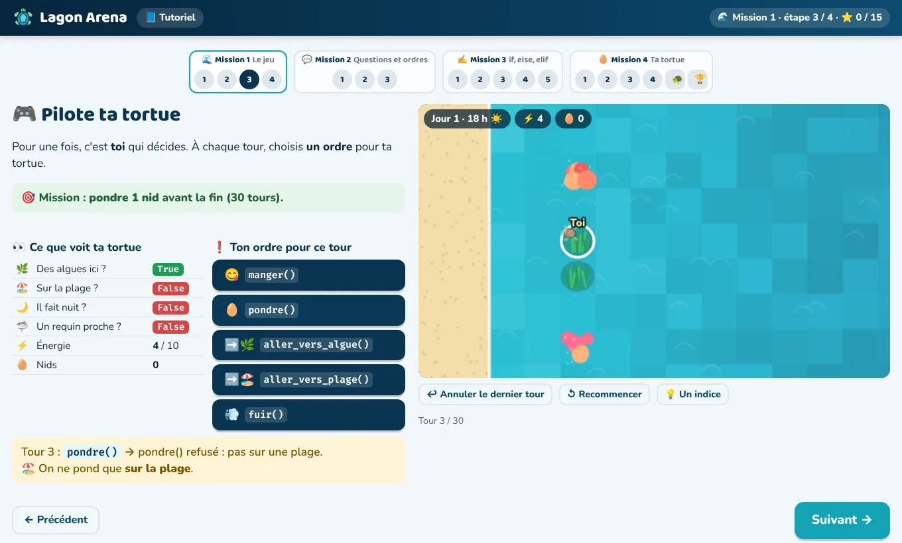
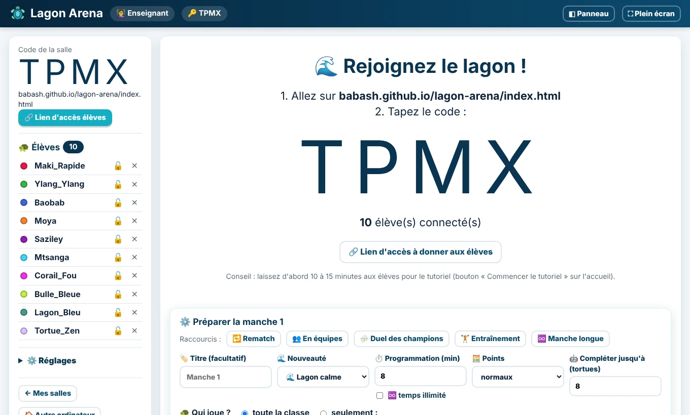
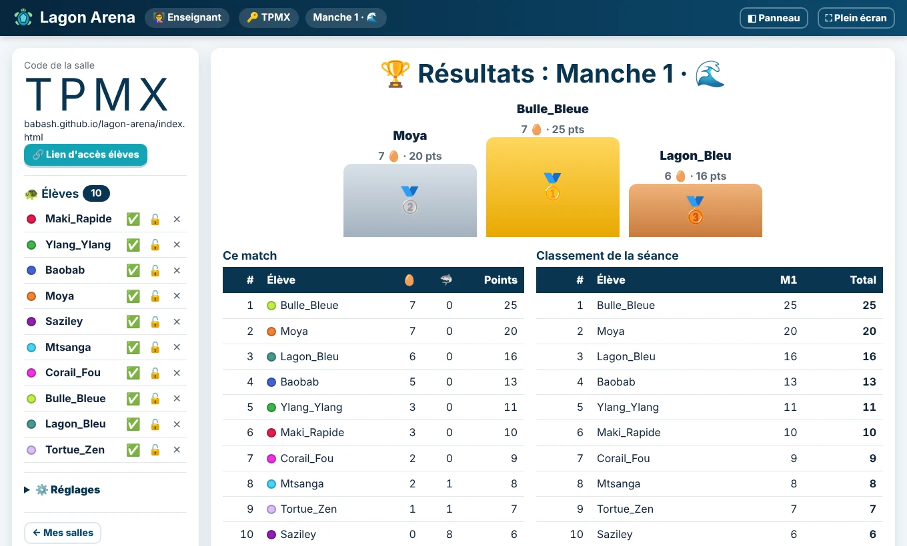
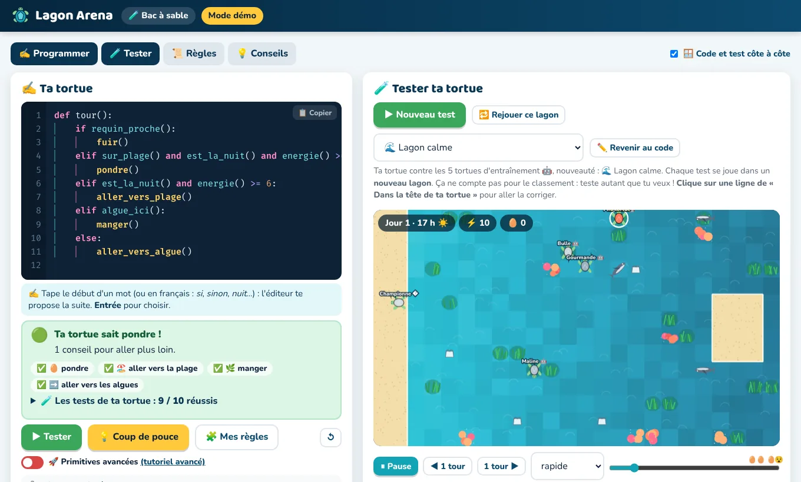
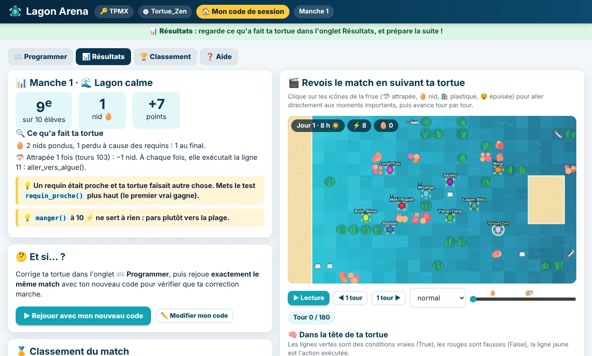

# 👩‍🏫 Guide de l'enseignant

[← Retour au README](../README.md) · [Règles](REGLES.md) · [Pédagogie](PEDAGOGIE.md)

Tout ce qu'il faut pour mener une séance, donner un devoir ou laisser les élèves s'entraîner. Les règles détaillées du jeu sont dans [REGLES.md](REGLES.md).

---

## 1. Les pages du site

| Page | Pour qui | Rôle |
|---|---|---|
| `index.html` | tous | Accueil en deux vues : **🐢 élève** (entrer dans la partie avec la salle et un pseudo, ou avec le seul code de session ; le parcours en 4 missions avec sa progression ; les règles en 1 minute ; bac à sable, missions avancées, Panthéon) et **👩‍🏫 enseignant** (le jeu en bref, créer une salle ou un devoir, mode démo, documentation), avec le nombre de parties jouées et de participants |
| `tuto.html` | élèves débutants (dès la Seconde) | **Parcours en 4 missions** (`tuto.html?mission=1` à `4`) : comprendre le jeu sans code (🎮 piloter sa tortue à la main), parler à sa tortue (règles en français), premières règles en Python (d'abord avec des listes, puis au clavier), une tortue qui pond. L'élève en sort avec **une tortue qui pond** |
| `tuto-avance.html` | élèves à l'aise | **Tutoriel avancé** en 3 niveaux : 🥈 intermédiaire, 🥇 expert, 👥 équipe |
| `eleve.html` | élèves | Programmer, tester, envoyer sa tortue ; résultats, rapport, « Et si… ? », classement, aide |
| `eleve.html?libre=1` | élèves | **Bac à sable** seul, sans salle (pour s'entraîner n'importe quand) |
| `prof.html` | enseignant | Créer une salle ou un devoir, lancer les manches, projeter les brawls, podium, export CSV |
| `pantheon.html` | tous | Le **Panthéon** : les 100 meilleures tortues de tous les temps, classement par établissement |

## 2. Le déroulé conseillé d'une séance (≈ 55 min)

| Temps | Élèves | Enseignant (écran projeté) |
|---|---|---|
| 0–15 min | Font les **missions 1 et 2** du parcours (`index.html` → « 🗺️ Ton parcours ») ; les missions 3 et 4 peuvent se finir en devoir, ou au cours suivant | Crée la salle dans `prof.html` (avec le nom de l'établissement, si on le souhaite) : le code s'affiche en grand |
| 15 min | Rejoignent la salle (code + pseudo) | Voit les élèves arriver, puis clique sur **▶ Lancer la manche 1** |
| 15–23 min | Programment, testent dans le bac à sable, **envoient** leur tortue | Chrono géant ; l'état de chaque tortue (🟢 🟠 🔴 🐞 ⏳) et « 🥚 12 tortues sur 25 pondent » : un clic pour voir qui bloque, et pourquoi |
| 23–25 min | « Brawl en cours, regarde le tableau » | **Lancer le brawl** : match animé, classement en direct, fil des événements |
| 25–28 min | Onglet **Résultats** : rang, rapport, conseils, rejeu de *leur* tortue avec ses pensées, « Et si… ? » | Podium de la manche, classement de la séance, la meilleure tortue entre au **Panthéon** ; un clic sur un élève : son code et ses tests |
| 28–40 min | **Rematch** (manche 2, invasion de plastique), 6 min | Idem |
| 40–52 min | **Finale** (manche 3), par exemple **en équipes** | Idem |
| 52–55 min | (Duel des champions) puis bilan | Podium final, meilleure progression, **export CSV** |

### Ce qu'on peut dire aux élèves pour lancer la séance (1 minute)

> « Aujourd'hui, vous n'allez pas jouer : vous allez **programmer quelqu'un qui joue à votre place**. Chacun de vous a une tortue de mer. Son but : pondre un maximum de nids sur la plage, la nuit, sans se faire manger par les requins. Pendant le match, vous ne toucherez à rien : votre tortue obéira **uniquement** au programme que vous aurez écrit avant, avec des `if`. Toutes les tortues de la classe vont nager **en même temps**, ici, au tableau.
>
> La tortue qu'on vous donne au départ sait manger… mais elle ne pond jamais. Si vous ne changez rien, vous aurez zéro. Après chaque match, vous pourrez revoir votre tortue tour par tour, voir ce qu'elle « pensait », comprendre pourquoi elle s'est fait attraper, la corriger… et il y aura un rematch.
>
> Pas besoin de savoir programmer : commencez par les missions de l'accueil, la première se joue sans code. Un pseudo, pas votre vrai nom. Allez, à l'eau ! »

## 3. Préparer la manche suivante

Avant chaque manche (dans la salle d'attente, puis sous les résultats de la manche précédente), le panneau **⚙️ Préparer la manche** permet de tout régler :

- **raccourcis** : 🔁 Rematch (manche suivante classique), 👥 En équipes, ⛈️ Duel des champions, 🏋️ Entraînement (hors classement), ♾️ Manche longue ;
- **titre** de la manche (affiché aux élèves et sur l'écran projeté) ;
- **nouveauté** : lagon calme, plastique, requins affamés, nuits courtes, finale, tempête (voir [REGLES.md](REGLES.md#7-les-nouveautés-de-manche)) ;
- **🗺️ Personnaliser le lagon** (facultatif) : en partant de la nouveauté, réglez le nombre de requins (0 à 6), leur vitesse et leur vue, le nombre de sacs plastique et leur place, les heures de nuit, le nombre de massifs de corail et de touffes d'algues. Une case vide garde la valeur de la nouveauté (affichée en gris). La carte reste toujours vérifiée sans blocage ; les élèves voient ce lagon et s'y entraînent dans leur bac à sable ;
- **durée de programmation**, ou **♾️ temps illimité** (voir plus bas) ;
- **points** : normaux, doubles, ou hors classement ;
- **nombre de tortues minimum** (complété par des 🤖 ; 0 pour aucune) ;
- **qui joue** : toute la classe, ou seulement les élèves cochés ;
- **mode** : chacun pour soi, ou en équipes :
  - de 2 à 6 équipes, la couleur de chaque équipe est attribuée automatiquement ;
  - 🎲 **Au hasard** ou ⚖️ **Équilibrées** (d'après le classement de la séance, en « serpent » : les meilleurs sont répartis entre les équipes) ;
  - **à la main** : cliquer sur un nom puis sur l'équipe où le mettre, ou le faire glisser ; les équipes peuvent avoir des tailles différentes ;
  - un élève qui arrive en retard rejoint automatiquement l'équipe la plus petite.

Les réglages sont **publiés tout de suite** : les élèves voient la prochaine manche (et leur équipe) pendant qu'ils préparent leur tortue.

### Voir les codes et les difficultés des élèves

**Pendant la programmation**, la liste des élèves (à gauche) montre l'état de la **dernière tortue envoyée** par chacun, d'après les mêmes tests que ceux de l'élève :

| | |
|---|---|
| 🟢 | elle sait pondre |
| 🟠 | elle peut pondre, mais rate une situation clé (elle mange la nuit au lieu de rentrer…) |
| 🔴 | elle ne pondra jamais (deux blocs `if` à la suite, pas de `pondre()`, règles dans le mauvais ordre…) |
| 🐞 | une erreur dans le code |
| ⏳ | rien envoyé : c'est la tortue de départ qui jouera |

Une icône pâle : la tortue date d'une manche précédente (l'élève ne l'a pas encore renvoyée). En haut de la liste, **« 🥚 12 tortues sur 25 pondent »** : un clic ouvre **🩺 Les tortues de la classe**, les causes regroupées (« 4 · deux blocs `if` à la suite »). Un clic sur une cause montre les élèves concernés.

**Un clic sur un pseudo** ouvre sa **fiche** : son code en couleur, ses tests (le verdict, les situations ratées, l'explication ligne par ligne) et un bouton pour copier le code. Les autres élèves ne voient jamais ce code avant le brawl.

**Après le brawl**, un clic sur un élève dans le tableau « Ce match » ouvre sa fiche avec, en plus, ses nids, ses captures, ses épuisements et **▶ Revoir le match en suivant cette tortue** (avec sa pensée). Sous les tableaux, **🩺 Les tortues de la classe** résume le match : « 🥚 18 tortues sur 25 ont pondu. Les 7 autres : 4 · deux blocs `if` à la suite, 2 · manger passe avant pondre… ».

> ⚠️ **Attention au projecteur** : la fiche est visible au tableau si votre écran est projeté. Elle s'ouvre avec un avertissement et un bouton **🙈 Masquer** (la touche Échap marche aussi).

En fin de séance, **⬇️ Exporter le classement (CSV)** peut inclure le code joué par chaque élève à chaque manche (case « avec les codes des tortues »).

## 4. Le devoir à la maison

Sur l'accueil enseignant, **📚 Créer un devoir** crée une salle « hors cours » :

1. La salle s'ouvre avec la **manche 1 déjà préparée en temps illimité** (titre « Devoir »). Choisissez la **nouveauté** (calme, plastique, tempête…), éventuellement un **lagon personnalisé**, les **équipes**, les points…
2. Cliquez sur **▶ Lancer le devoir**. Une fenêtre donne :
   - le **lien d'accès** à donner aux élèves (`https://babash.github.io/lagon-arena/index.html?salle=ABCD`), avec son QR code ;
   - un **message prêt à envoyer** (messagerie de l'établissement, cahier de textes…), modifiable, avec le lien et les consignes.
3. Un élève qui ouvre le lien arrive sur l'accueil avec la salle déjà remplie et un encadré « Tu es invité·e » : le tutoriel d'abord s'il n'a jamais joué (il revient ensuite dans la salle), puis son pseudo. À sa première visite, son **code de session** s'affiche tout de suite.
4. Vous lancez le brawl **quand vous voulez**, en classe ou de chez vous (« 🏠 Autre ordinateur »).

Pendant toute la manche longue, vous pouvez encore **changer la nouveauté** (menu sous le titre de l'écran projeté) : les élèves la voient changer sur leur page et dans leur bac à sable.

Le bouton **🔗 Lien d'accès élèves** de la salle redonne le lien et le message à tout moment, pour une séance en classe aussi. L'adresse du site utilisée dans les liens est réglée dans `js/config.js` (`URL_SITE`).

## 5. La manche longue : continuer à la maison

- Cochez **♾️ temps illimité** (ou le raccourci ♾️ Manche longue) : la manche reste ouverte, sans chrono, **jusqu'à ce que vous lanciez le brawl**, par exemple au cours suivant. Les élèves programment, testent et renvoient leur tortue quand ils veulent, y compris depuis chez eux. Le moment venu, « ⏱️ Chrono de 5 min » remet un compte à rebours, ou lancez directement le brawl.
- **Code de session** : chaque élève a un code de 8 caractères (ex. `R8GS-Z4AN`), visible avec le bouton **🏠 Mon code de session** de sa page. Sur un autre ordinateur, il clique sur « 🏠 J'ai un code de session » et tape **seulement ce code** : sa salle et son pseudo sont retrouvés tout seuls (son lien personnel, `…/index.html#code=…`, ouvre même directement sa partie). Sur le même navigateur, « ▶ Reprendre ma partie » suffit. Il retrouve sa dernière tortue envoyée et ses points. Le bouton **🔑 Codes de session** de la salle vous en donne la liste (imprimable), si un élève a oublié le sien.
- **Vous aussi, depuis un autre ordinateur** : le bouton **🏠 Autre ordinateur** de la salle donne un **lien enseignant** à ouvrir chez vous. Ne le donnez pas aux élèves : il permet de piloter la salle.
- Une salle est gardée **60 jours** après sa dernière utilisation.

## 6. Le Panthéon

Le [Panthéon](https://babash.github.io/lagon-arena/pantheon.html) classe les **100 meilleures tortues de tous les temps**, toutes classes confondues. Chaque tortue y est affichée avec **le pseudo, la classe et la date** (« Moya · classe K7PQ · 6 nov. 2026 »), plus l'établissement s'il est renseigné : deux élèves de classes différentes peuvent donc avoir le même pseudo. Depuis son bac à sable, un élève clique sur **🏛️ Proposer au Panthéon** :

- sa tortue joue **20 parties** dans le lagon calme contre les 5 tortues d'entraînement, sur **les mêmes 20 lagons pour tout le monde** : son score est sa **moyenne de nids** ;
- **depuis la salle**, sa tortue est inscrite avec **son pseudo de la salle** et **sa classe** (le code de la salle, prouvé par son jeton de session), et avec l'établissement que l'enseignant a renseigné en créant la salle. Il n'a rien à taper ;
- **depuis le bac à sable seul**, elle est affichée « hors classe » : il choisit un pseudo et, s'il le veut, un établissement ;
- on peut afficher le classement d'un seul établissement ;
- il reçoit un **code Panthéon** pour améliorer sa tortue plus tard : la nouvelle version remplace l'ancienne si elle fait mieux (et reste rattachée à sa classe, même améliorée depuis chez lui) ;
- son **programme est gardé mais jamais lisible** ; on ne peut pas entrer deux fois avec le même programme, ni avec une tortue d'entraînement ou une stratégie des tutoriels recopiée telle quelle.

Les tortues d'entraînement apparaissent dans le classement comme **repères** (la Championne fait 5,5 nids en moyenne sur ce banc d'essai). Chaque score est **recalculé** par l'administrateur du site (⏳ puis ✔), qui peut aussi retirer une tortue au pseudo ou à l'établissement inapproprié.

C'est un bon objectif pour les élèves rapides, ou pour prolonger le travail à la maison : « Entrez au Panthéon, et battez la Championne ! »

### Le Panthéon automatique

À la fin de **chaque manche**, quand les résultats s'affichent, votre navigateur envoie **la meilleure tortue de la classe** au Panthéon, sans que personne ait rien à faire :

- elle doit avoir pondu au moins un nid pendant le match, et être un programme **inventé par l'élève** (pas la tortue de départ, une tortue d'entraînement, une solution des tutoriels ni un programme du coup de pouce) ;
- elle passe le même banc d'essai de 20 parties (quelques secondes, la page reste utilisable), puis elle est inscrite avec **le pseudo, la classe** (le code de la salle), l'établissement et la date ;
- au tableau : « 🏛️ **Maki_Rapide entre au Panthéon (12e) !** » ;
- l'élève le voit dans ses résultats (« 🏛️ Ta tortue entre au Panthéon à la 12e place ! »), avec **son code Panthéon** pour l'améliorer plus tard ;
- même programme déjà au Panthéon : il n'est pas ajouté ; même élève de la même salle : sa tortue est remplacée seulement si la nouvelle fait mieux ;
- comme les autres, le score reste ⏳ jusqu'à la vérification de l'administrateur.

Dans **⚙️ Réglages** (colonne de gauche) : décocher « 🏛️ Envoyer les meilleures tortues au Panthéon », ou choisir **les 3 meilleures** de chaque manche au lieu d'une seule. Ces réglages sont gardés 60 jours dans votre navigateur.

## 7. Ce que voit l'élève

La page a **6 onglets** au même niveau : **✍️ Programmer · 🧪 Tester · 📊 Résultats · 🏆 Classement · 📜 Règles · 💡 Conseils**. Sur un grand écran, la case « 🪟 Code et test côte à côte » affiche Programmer et Tester ensemble.

**Pour écrire son programme** :

- **Autocomplétion** :
  - l'élève tape le début d'un mot et l'éditeur propose la suite, avec le rôle de chaque primitive ;
  - on peut aussi taper en français : *si*, *sinon*, *et*, *pas*, *nuit*, *plage*… ;
  - les propositions tiennent compte de l'endroit : des questions après un `if`, des ordres en début de ligne.
- **Boîte à outils** : toutes les primitives en boutons, rangées par thème quand elles sont nombreuses (🦈 requins, 🌿 algues, 🏖️ plage et heure, ⚡ moi, 🐢 tortues autour, 👥 équipe ; 🥚 manger et pondre, 🧭 se déplacer, 🛡️ se protéger, 🤝 agir sur les autres). Un clic insère le mot et rappelle son rôle. L'autocomplétion trouve aussi par thème (« danger », « nourriture »…).
- **Barre d'info** : le rôle du mot sous le curseur.
- **Indentation visible** : un trait vertical coloré par niveau. Sur un `if`, un `elif` ou un `else`, les mots-clés qui vont ensemble sont surlignés (« Ce `else` va avec le `if` de la ligne 5 »).
- **Deux-points ajoutés automatiquement** quand on les oublie après `if`, `elif` ou `else` (l'éditeur le signale), et **indentation automatique**.
- **🧪 Les tests de la tortue**, sous l'éditeur, à chaque modification : un verdict en une ligne (🟢 « Ta tortue sait pondre ! », 🟠 « peut pondre, mais pas souvent », 🔴 « ne pondra jamais »), les 4 actions clés (pondre, aller vers la plage, manger, aller vers les algues), puis le tableau de 10 situations (« 🌙 La nuit, sur la plage → on attend `pondre()` → ta tortue fait `manger()` ligne 3 ❌ »). Chaque ❌ dit **quelle ligne agit à la place, et pourquoi** (« une seule action par tour », « le premier vrai gagne », « `energie() >= 9` est faux »), et les lignes en cause sont surlignées dans le code. Les tests ne bloquent jamais : la tortue peut toujours être testée et envoyée.
- **💡 Coup de pouce** : l'idée suivante d'après les tests de la tortue (d'abord la faire pondre, avec la vraie cause : deux blocs à la suite, mauvais ordre…), en 5 paliers (pondre la nuit sur la plage, se méfier des requins, vérifier l'énergie, éviter le plastique, partir avant la nuit ; en équipes, « Aide ton équipe ! »). Chaque palier montre un programme complet, les lignes à ajouter en vert : l'élève les recopie lui-même.
- **🧩 Mes règles** : les règles de la tortue numérotées dans l'ordre où Python les lit (« 1. Si `requin_proche()` → `fuir()` »), avec ⬆️ ⬇️ pour changer leur priorité et 🗑️ pour en retirer une. **➕ Ajouter une règle** : une question, un ordre et la place (« tout en haut », « après la règle 2 ») choisis dans des listes ; le code s'écrit tout seul, toujours en une seule chaîne `if` / `elif` / `else`. Idéal pour les élèves qui bloquent sur la syntaxe.
- **📌 L'aide-mémoire**, toujours visible sous l'éditeur : 🥚 = 🏖️ plage + 🌙 nuit + ⚡ 6 · 🌿 +3 ⚡ · 🛍️ −3 ⚡ · 🦈 −1 nid · 1 action par tour.
- **📤 Envoyer** : l'état se lit sur le bouton (« ✅ Envoyée à 14:05 », « ⚠️ Modifiée : renvoyer »).
- **📜 Règles** : les règles en **6 cartes** (le but, pondre, l'énergie, les requins, le temps, ton programme), le modèle en français et en Python, puis le détail à déplier. **💡 Conseils** : l'essentiel en 5 lignes, puis construire sa tortue pas à pas, comprendre pourquoi ça ne marche pas, erreurs fréquentes, conseils par niveau et par nouveauté.
- **🚀 Primitives avancées** : ajoute les primitives des niveaux intermédiaire et expert à l'autocomplétion, à la boîte à outils et à l'aide ; la tortue Pirate 🤖 rejoint le bac à sable.

**Pour tester** (onglet 🧪 Tester) :

- **▶ Tester** (sous l'éditeur) ouvre l'onglet et lance la partie. Le lagon et **« Dans la tête de ta tortue »** sont côte à côte, en grand ; **un clic sur une ligne de la pensée ramène à cette ligne dans l'éditeur** ;
- chaque test se joue dans un **nouveau lagon** ; « 🔁 Rejouer ce lagon » rejoue le même (pour vérifier une correction) ;
- **📊 Estimer** : la tortue joue 10, 20 ou 50 parties **sans les afficher**. L'élève obtient son **nombre d'œufs moyen**, de la pire à la meilleure partie, la part des parties sans œuf, ses captures, et la moyenne de chaque tortue d'entraînement. Ce sont toujours les mêmes lagons : l'élève compare ses versions (« Estimation précédente : 1,2 → maintenant 2,8 »).

**Après chaque brawl** (onglet Résultats) :

- son rang, ses nids, ses points ;
- **ce qu'a fait sa tortue** (nids pondus, captures, épuisements) et des **conseils qui donnent le code à écrire** (« Attrapée en train de manger ! Mets tout en haut : `if requin_proche():` puis `fuir()` ») ;
- le **rejeu du match en suivant sa tortue**, avec une frise des moments importants et **« Dans la tête de ta tortue »** : à chaque tour, les conditions vraies en vert, les fausses en rouge, l'action exécutée en jaune ;
- **🤔 Et si… ?** : rejouer **exactement le même match** avec son code corrigé, pour vérifier que la correction marche.

## 8. Les tutoriels

### Le parcours débutant en 4 missions (`tuto.html`)

Le tutoriel est un **parcours en 4 missions** (environ 30 minutes en tout), affiché sur l'accueil avec la progression de l'élève (✅ réussie, ⏳ en cours, 👉 à faire maintenant). On peut s'arrêter entre deux missions. Il convient **dès la Seconde** : la première mission se joue sans code, et le clavier n'arrive qu'à la mission 3. Chaque étape montre d'abord un exemple à manipuler, puis un petit exercice vérifié tout de suite ; une étoile ⭐ marque chaque exercice réussi.

**🌊 Mission 1 · Comprendre le jeu** (5 min, sans code)
1. **Le jeu** : le but en une phrase et un match de démonstration animé.
2. **Le lagon** : la légende illustrée.
3. **🎮 Pilote ta tortue** : l'élève choisit lui-même l'ordre de sa tortue, tour par tour (manger, pondre, aller vers les algues ou la plage, fuir), pour pondre 1 nid. Il voit ce que « voit » sa tortue (algues ? plage ? nuit ? requin ?), son énergie, et pourquoi un ordre est refusé (« il fait jour », « pas sur une plage », « pas assez d'énergie »). Il découvre ainsi les règles en les vivant, puis comprend qu'en classe il faudra écrire ces décisions **à l'avance**.
4. **Les règles en 1 minute** : les 6 cartes, une jauge d'énergie à manipuler et un vrai / faux.

**💬 Mission 2 · Parler à ta tortue** (5 min)
1. **Les questions (capteurs)** : un quiz en images (« Que répond `algue_ici()` ? True ou False ? »).
2. **Les ordres (actions)** : un quiz « quel ordre donner dans cette situation ? ».
3. **Si… alors…** : trois règles à composer **en français** avec deux listes (« Si 🦈 un requin est proche → 💨 fuir »). La traduction en Python s'affiche dessous.

**✍️ Mission 3 · Tes premières règles en Python** (10 min)
1. **Complète le code** : la même règle en français puis en Python ; l'élève complète `if ___:` / `___` avec des listes déroulantes, sans clavier.
2. **Ton premier `if`** : un `if` décortiqué en couleurs, un interrupteur True/False, puis l'élève l'écrit au clavier.
3. **`else`**, 4. **`and`**, 5. **`elif`, le premier vrai gagne** : un exemple à manipuler, puis un exercice ou un quiz.

**🥚 Mission 4 · Une tortue qui pond** (10 min)
1. **Une seule chaîne** : une tortue à deux blocs `if` / `else` à la suite (le piège le plus fréquent en classe) ; l'élève la répare en une seule chaîne.
2. **L'ordre des priorités** : 4 règles à ranger avec des flèches, vérifiées dans 6 situations.
3. et 4. **2 tortues à réparer** dans le lagon, chacune avec un indice ; « Voir la solution » apparaît après 2 essais.

    | Mission | Notion | Ce qui ne va pas |
    |---|---|---|
    | 🔧 3 | ordre des règles | La nuit, elle mange au lieu d'aller pondre. |
    | 🔧 4 | ordre des `elif` | Elle mange alors qu'un requin arrive. |

5. **🐢 Construis ta tortue** : la tortue de départ de la partie, à compléter avec ses **tests en direct** jusqu'au 🟢, au clavier ou avec **🧩 Ajouter une règle sans taper**. « 🐢 Emporter ma tortue » la place dans l'éditeur de la partie (ou du bac à sable).
6. **En classe** : le déroulé de la séance et le barème des points.

Quand un exercice ou une mission échoue, l'élève voit **pourquoi** : « 🔍 La nuit, sur la plage : ta tortue fait `manger()` (ligne 3), parce que `algue_ici()` est vrai. La ligne 5 `pondre()` n'est même pas regardée : le premier vrai gagne. »

### Le tutoriel avancé (`tuto-avance.html`)

Il ne remplace pas le premier : il ajoute des primitives **cachées par défaut**, pour ne pas noyer les débutants. Trois niveaux, à faire dans l'ordre ou directement ; chacun a sa progression (⭐).

**🥈 Intermédiaire** (`?niveau=moyen`)

| Étape | Contenu |
|---|---|
| 1 | Le lagon bouge : un lagon différent à chaque partie, algues qui s'épuisent et repoussent ailleurs, sacs qui dérivent, soleil sur la plage |
| 2 | Les distances : `distance_algue()`, `distance_plage()`, `distance_requin()`, avec des curseurs et un quiz « vrai ou faux » |
| 3 | `or` et `not` (et les parenthèses), puis un exercice |
| M1 | Mission « Le buffet est pris » : `aller_vers_algue_libre()` |
| 4 | Pousser : `pousser()`, `tortue_a_cote()`, `requin_derriere_tortue()`, puis un exercice |
| M2 | Mission « La pirate » : pousser une rivale sur un requin |
| 5 | Anticiper la nuit avec `heure()` et `distance_plage()` |
| 🏆 | Le défi : lire le code de la **Pirate** 🤖 et la battre (vérifier avec 📊 Estimer) |

**🥇 Expert** (`?niveau=expert`) : lire le lagon, choisir ses algues

| Étape | Contenu |
|---|---|
| 1 | Lire le lagon : les 6 capteurs « choisir ses algues », avec des curseurs |
| 2 | Comparer deux choix (quiz) : `distance_algue_sure() <= distance_algue() + 3`, zone à quitter… |
| 3 | La zone dangereuse : `requins_autour()`, `requins_pres_algue()` (exercice) |
| 4 | Le bon repas : `portions_algue()`, `algues_autour()` (exercice) |
| 5 | Dîner près de la plage : `algue_pres_plage()` et `heure()` (exercice) |
| 🏆 | Le défi : une stratégie d'expert (elle bat la Championne en moyenne) à améliorer avec 📊 Estimer |

**👥 Équipe** (`?niveau=equipe`)

| Étape | Contenu |
|---|---|
| 1 | Jouer en équipe : les règles, `donner()`, `aller_vers_equipiere()`, la protection à deux |
| 2 | S'entraider (exercice) : `equipiere_fatiguee()`, `requin_derriere_adversaire()` |
| M | Mission « La nourrice » : donner de l'énergie à une équipière épuisée pour que l'équipe ponde |
| 3 | Plusieurs équipes, l'équipe rivale : `rang_equipe()`, `equipe_en_tete()`, `rivale_a_cote()`… (exercice) |
| 🏆 | Une stratégie d'équipe, et des conseils pour se répartir les rôles |

## 9. Conseils pratiques

- À 0 au chrono, les tortues modifiées mais non envoyées partent automatiquement (si le code est correct).
- Un élève qui n'envoie rien joue avec sa dernière tortue envoyée, ou avec la tortue de départ.
- « Terminer le chrono » laisse 5 secondes aux élèves ; « +1 min » rallonge le temps.
- **◧ Panneau** masque la colonne de gauche (elle est masquée automatiquement pendant le brawl). **⛶ Plein écran** sert pour le vidéoprojecteur.
- La salle est pilotée **depuis le navigateur qui l'a créée** : le jeton enseignant y est enregistré (60 jours). On la reprend plus tard depuis « Reprendre une salle », ou depuis un autre ordinateur avec le lien enseignant.
- **Postes partagés** : ce qu'un élève laisse dans le navigateur (pseudo, programme, progression des tutoriels) est effacé **au bout d'un jour**. Pour revenir le lendemain, il lui suffit de son **code de session** : rappelez-leur de le noter.
- **Ménage automatique** : une séance terminée (« Terminer la séance ») est effacée au bout de **7 jours** (le temps d'exporter le CSV), une salle jamais commencée aussi, et une salle sans aucune activité au bout de **60 jours**.
- **Arriver en cours de partie** : un élève peut rejoindre la salle à tout moment avec le code. L'écran projeté l'annonce (« 🆕 … rejoint la partie ») et sa tortue joue au brawl suivant.
- **Changer d'ordinateur** : l'élève se reconnecte avec son **code de session**. S'il l'a perdu, cliquez sur 🔓 à côté de son nom : il pourra reprendre son pseudo sans code, avec ses tortues et ses points.
- Le bouton ✕ retire un élève et ses tortues (pseudo inapproprié, doublon). Faites-le de préférence avant le premier brawl.
- **Pendant le rapport** (2-3 minutes après chaque brawl), circulez : demandez à un élève de vous **expliquer** ce qu'a fait sa tortue à un moment de la frise. C'est là que se joue l'apprentissage.

## 10. Le mode démo : découvrir seul

Ouvrez [l'espace enseignant en mode démo](https://babash.github.io/lagon-arena/prof.html?demo) : tout reste dans votre navigateur, rien n'est enregistré en ligne.

- créez une salle ;
- cliquez sur **🤖 + 3 élèves fictifs**, ou sur **➕ Ouvrir un élève** pour jouer un élève dans un autre onglet ;
- lancez les manches.

Le bac à sable et les tutoriels fonctionnent toujours sans base de données.
