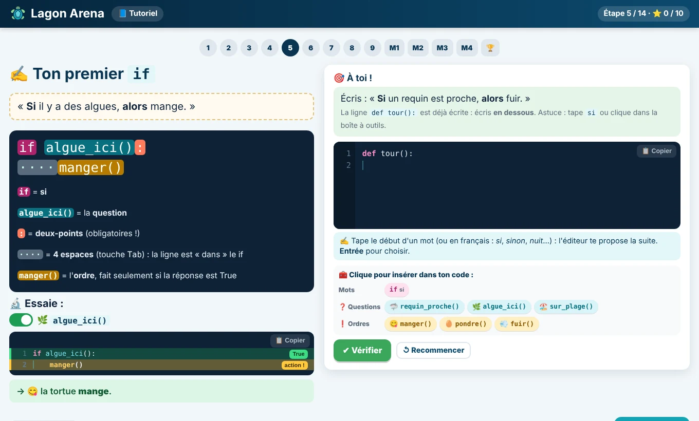
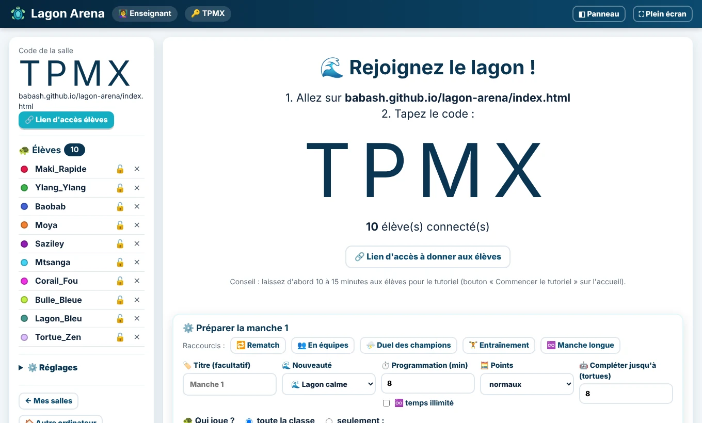
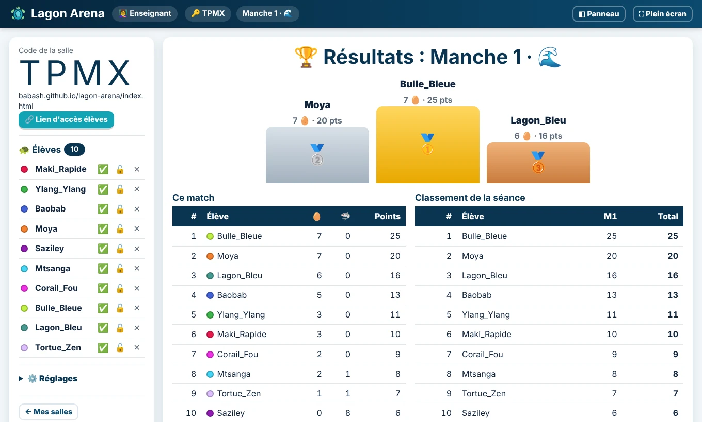
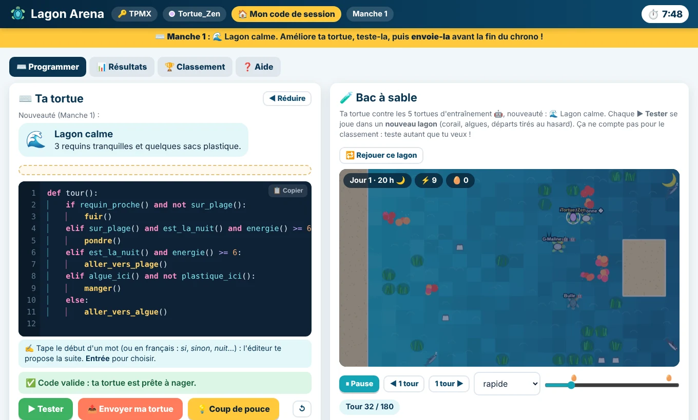
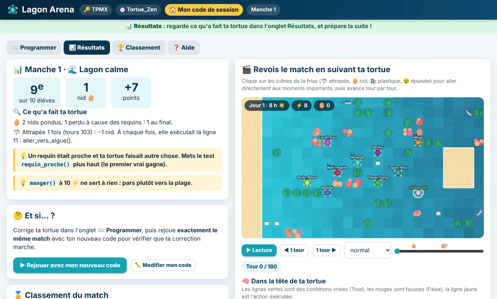

# 👩‍🏫 Guide de l'enseignant

[← Retour au README](../README.md) · [Règles](REGLES.md) · [Pédagogie](PEDAGOGIE.md)

Tout ce qu'il faut pour mener une séance, donner un devoir ou laisser les élèves s'entraîner. Les règles détaillées du jeu sont dans [REGLES.md](REGLES.md).

---

## 1. Les pages du site

| Page | Pour qui | Rôle |
|---|---|---|
| `index.html` | tous | Accueil en deux vues : **🐢 élève** (rejoindre une salle, tutoriel, bac à sable, Panthéon) et **👩‍🏫 enseignant** (le jeu en bref, créer une salle ou un devoir, mode démo, documentation), avec le nombre de parties jouées et de participants |
| `tuto.html` | élèves débutants | **Tutoriel** en 14 étapes courtes : un exemple à manipuler, puis un petit exercice vérifié tout de suite |
| `tuto-avance.html` | élèves à l'aise | **Tutoriel avancé** en 3 niveaux : 🥈 intermédiaire, 🥇 expert, 👥 équipe |
| `eleve.html` | élèves | Programmer, tester, envoyer sa tortue ; résultats, rapport, « Et si… ? », classement, aide |
| `eleve.html?libre=1` | élèves | **Bac à sable** seul, sans salle (pour s'entraîner n'importe quand) |
| `prof.html` | enseignant | Créer une salle ou un devoir, lancer les manches, projeter les brawls, podium, export CSV |
| `pantheon.html` | tous | Le **Panthéon** : les 100 meilleures tortues de tous les temps, classement par lycée |

## 2. Le déroulé conseillé d'une séance (≈ 55 min)

| Temps | Élèves | Enseignant (écran projeté) |
|---|---|---|
| 0–15 min | Font le **tutoriel** (`index.html` → « Commencer le tutoriel ») | Crée la salle dans `prof.html` : le code s'affiche en grand |
| 15 min | Rejoignent la salle (code + pseudo) | Voit les élèves arriver, puis clique sur **▶ Lancer la manche 1** |
| 15–23 min | Programment, testent dans le bac à sable, **envoient** leur tortue | Chrono géant ; ✅ ou ⏳ pour chaque élève |
| 23–25 min | « Brawl en cours, regarde le tableau » | **Lancer le brawl** : match animé, classement en direct, fil des événements |
| 25–28 min | Onglet **Résultats** : rang, rapport, conseils, rejeu de *leur* tortue avec ses pensées, « Et si… ? » | Podium de la manche et classement de la séance |
| 28–40 min | **Rematch** (manche 2, invasion de plastique), 6 min | Idem |
| 40–52 min | **Finale** (manche 3), par exemple **en équipes** | Idem |
| 52–55 min | (Duel des champions) puis bilan | Podium final, meilleure progression, **export CSV** |

### Ce qu'on peut dire aux élèves pour lancer la séance (1 minute)

> « Aujourd'hui, vous n'allez pas jouer : vous allez **programmer quelqu'un qui joue à votre place**. Chacun de vous a une tortue de mer. Son but : pondre un maximum de nids sur la plage, la nuit, sans se faire manger par les requins. Pendant le match, vous ne toucherez à rien : votre tortue obéira **uniquement** au programme que vous aurez écrit avant, avec des `if`. Toutes les tortues de la classe vont nager **en même temps**, ici, au tableau.
>
> La tortue qu'on vous donne au départ sait manger… mais elle ne pond jamais. Si vous ne changez rien, vous aurez zéro. Après chaque match, vous pourrez revoir votre tortue tour par tour, voir ce qu'elle « pensait », comprendre pourquoi elle s'est fait attraper, la corriger… et il y aura un rematch.
>
> Pas besoin de savoir programmer : commencez par le tutoriel, il vous apprend tout en quinze minutes. Un pseudo, pas votre vrai nom. Allez, à l'eau ! »

## 3. Préparer la manche suivante

Avant chaque manche (dans la salle d'attente, puis sous les résultats de la manche précédente), le panneau **⚙️ Préparer la manche** permet de tout régler :

- **raccourcis** : 🔁 Rematch (manche suivante classique), 👥 En équipes, ⛈️ Duel des champions, 🏋️ Entraînement (hors classement), ♾️ Manche longue ;
- **titre** de la manche (affiché aux élèves et sur l'écran projeté) ;
- **nouveauté** : lagon calme, plastique, requins affamés, nuits courtes, finale, tempête (voir [REGLES.md](REGLES.md#7-les-nouveautés-de-manche)) ;
- **🗺️ Personnaliser le lagon** (facultatif) : en partant de la nouveauté, réglez le nombre de requins (0 à 6), leur vitesse et leur vue, le nombre de sacs plastique et leur place, les heures de nuit, le nombre de massifs de corail et de touffes d'algues. Une case vide garde la valeur de la nouveauté (affichée en gris). La carte reste toujours vérifiée sans blocage ; les élèves voient ce lagon et s'y entraînent dans leur bac à sable ;
- **durée de programmation**, ou **♾️ temps illimité** (voir plus bas) ;
- **points** : normaux, doubles, ou hors classement ;
- **nombre de tortues minimum** (complété par des 🤖 ; 0 pour aucune) ;
- **qui joue** : toute la classe, ou seulement les élèves cochés ;
- **mode** : chacun pour soi, ou en équipes :
  - de 2 à 6 équipes, la couleur de chaque équipe est attribuée automatiquement ;
  - 🎲 **Au hasard** ou ⚖️ **Équilibrées** (d'après le classement de la séance, en « serpent » : les meilleurs sont répartis entre les équipes) ;
  - **à la main** : cliquer sur un nom puis sur l'équipe où le mettre, ou le faire glisser ; les équipes peuvent avoir des tailles différentes ;
  - un élève qui arrive en retard rejoint automatiquement l'équipe la plus petite.

Les réglages sont **publiés tout de suite** : les élèves voient la prochaine manche (et leur équipe) pendant qu'ils préparent leur tortue.

## 4. Le devoir à la maison

Sur l'accueil enseignant, **📚 Créer un devoir** crée une salle « hors cours » :

1. La salle s'ouvre avec la **manche 1 déjà préparée en temps illimité** (titre « Devoir »). Choisissez la **nouveauté** (calme, plastique, tempête…), éventuellement un **lagon personnalisé**, les **équipes**, les points…
2. Cliquez sur **▶ Lancer le devoir**. Une fenêtre donne :
   - le **lien d'accès** à donner aux élèves (`https://babash.github.io/lagon-arena/index.html?salle=ABCD`), avec son QR code ;
   - un **message prêt à envoyer** (messagerie de l'établissement, cahier de textes…), modifiable, avec le lien et les consignes.
3. Un élève qui ouvre le lien arrive sur l'accueil avec la salle déjà remplie et un encadré « Tu es invité·e » : le tutoriel d'abord s'il n'a jamais joué (il revient ensuite dans la salle), puis son pseudo. À sa première visite, son **code de session** s'affiche tout de suite.
4. Vous lancez le brawl **quand vous voulez**, en classe ou de chez vous (« 🏠 Autre ordinateur »).

Pendant toute la manche longue, vous pouvez encore **changer la nouveauté** (menu sous le titre de l'écran projeté) : les élèves la voient changer sur leur page et dans leur bac à sable.

Le bouton **🔗 Lien d'accès élèves** de la salle redonne le lien et le message à tout moment, pour une séance en classe aussi. L'adresse du site utilisée dans les liens est réglée dans `js/config.js` (`URL_SITE`).

## 5. La manche longue : continuer à la maison

- Cochez **♾️ temps illimité** (ou le raccourci ♾️ Manche longue) : la manche reste ouverte, sans chrono, **jusqu'à ce que vous lanciez le brawl**, par exemple au cours suivant. Les élèves programment, testent et renvoient leur tortue quand ils veulent, y compris depuis chez eux. Le moment venu, « ⏱️ Chrono de 5 min » remet un compte à rebours, ou lancez directement le brawl.
- **Code de session** : chaque élève a un code de 8 caractères (ex. `R8GS-Z4AN`), visible avec le bouton **🏠 Mon code de session** de sa page. Sur un autre ordinateur, il tape la salle, son pseudo, puis ce code dans « 🏠 Tu reviens depuis un autre ordinateur ? ». Il retrouve sa dernière tortue envoyée et ses points. Le bouton **🔑 Codes de session** de la salle vous en donne la liste (imprimable), si un élève a oublié le sien.
- **Vous aussi, depuis un autre ordinateur** : le bouton **🏠 Autre ordinateur** de la salle donne un **lien enseignant** à ouvrir chez vous. Ne le donnez pas aux élèves : il permet de piloter la salle.
- Une salle est gardée **60 jours** après sa dernière utilisation.

## 6. Le Panthéon

Le [Panthéon](https://babash.github.io/lagon-arena/pantheon.html) classe les **100 meilleures tortues de tous les temps**, toutes classes confondues. Depuis son bac à sable, un élève clique sur **🏛️ Proposer au Panthéon** :

- sa tortue joue **20 parties** dans le lagon calme contre les 5 tortues d'entraînement, sur **les mêmes 20 lagons pour tout le monde** : son score est sa **moyenne de nids** ;
- il choisit un pseudo et, s'il le veut, son **lycée** (on peut ensuite afficher le classement d'un seul lycée) ;
- il reçoit un **code Panthéon** pour améliorer sa tortue plus tard : la nouvelle version remplace l'ancienne si elle fait mieux ;
- son **programme est gardé mais jamais lisible** ; on ne peut pas entrer deux fois avec le même programme, ni avec une tortue d'entraînement ou une stratégie des tutoriels recopiée telle quelle.

Les tortues d'entraînement apparaissent dans le classement comme **repères** (la Championne fait 5,5 nids en moyenne sur ce banc d'essai). Chaque score est **recalculé** par l'administrateur du site (⏳ puis ✔), qui peut aussi retirer une tortue au pseudo ou au lycée inapproprié.

C'est un bon objectif pour les élèves rapides, ou pour prolonger le travail à la maison : « Entrez au Panthéon, et battez la Championne ! »

## 7. Ce que voit l'élève

**Pour écrire son programme** :

- **Autocomplétion** :
  - l'élève tape le début d'un mot et l'éditeur propose la suite, avec le rôle de chaque primitive ;
  - on peut aussi taper en français : *si*, *sinon*, *et*, *pas*, *nuit*, *plage*… ;
  - les propositions tiennent compte de l'endroit : des questions après un `if`, des ordres en début de ligne.
- **Boîte à outils** : toutes les primitives en boutons, rangées par thème quand elles sont nombreuses (🦈 requins, 🌿 algues, 🏖️ plage et heure, ⚡ moi, 🐢 tortues autour, 👥 équipe ; 🥚 manger et pondre, 🧭 se déplacer, 🛡️ se protéger, 🤝 agir sur les autres). Un clic insère le mot et rappelle son rôle. L'autocomplétion trouve aussi par thème (« danger », « nourriture »…).
- **Barre d'info** : le rôle du mot sous le curseur.
- **Indentation visible** : un trait vertical coloré par niveau. Sur un `if`, un `elif` ou un `else`, les mots-clés qui vont ensemble sont surlignés (« Ce `else` va avec le `if` de la ligne 5 »).
- **Deux-points ajoutés automatiquement** quand on les oublie après `if`, `elif` ou `else` (l'éditeur le signale), et **indentation automatique**.
- **💡 Coup de pouce** : l'idée suivante d'après ce qui manque dans le code, en 5 paliers (pondre la nuit sur la plage, se méfier des requins, vérifier l'énergie, éviter le plastique, partir avant la nuit ; en équipes, « Aide ton équipe ! »). Chaque palier montre un programme complet, les lignes à ajouter en vert : l'élève les recopie lui-même.
- **Rappels** : sous l'éditeur, une règle importante change toutes les 15 secondes.
- **❓ Aide**, en deux onglets : **📜 Règles** et **💡 Conseils**. Chacun commence par **l'essentiel en 5 lignes**, puis des sections à déplier pour les plus acharnés (toutes les règles ; construire sa tortue pas à pas, comprendre pourquoi ça ne marche pas, erreurs fréquentes, conseils par niveau et par nouveauté).
- **◀ Réduire** replie l'éditeur : le lagon du bac à sable prend toute la largeur, les boutons Tester / Envoyer restent visibles.
- **🚀 Primitives avancées** : ajoute les primitives des niveaux intermédiaire et expert à l'autocomplétion, à la boîte à outils et à l'aide ; la tortue Pirate 🤖 rejoint le bac à sable.

**Pour tester** (bac à sable) :

- chaque **▶ Tester** se joue dans un **nouveau lagon** ; « 🔁 Rejouer ce lagon » rejoue le même (pour vérifier une correction) ;
- **📊 Estimer** : la tortue joue 10, 20 ou 50 parties **sans les afficher**. L'élève obtient son **nombre d'œufs moyen**, de la pire à la meilleure partie, la part des parties sans œuf, ses captures, et la moyenne de chaque tortue d'entraînement. Ce sont toujours les mêmes lagons : l'élève compare ses versions (« Estimation précédente : 1,2 → maintenant 2,8 »).

**Après chaque brawl** (onglet Résultats) :

- son rang, ses nids, ses points ;
- **ce qu'a fait sa tortue** (nids pondus, captures, épuisements) et des **conseils qui donnent le code à écrire** (« Attrapée en train de manger ! Mets tout en haut : `if requin_proche():` puis `fuir()` ») ;
- le **rejeu du match en suivant sa tortue**, avec une frise des moments importants et **« Dans la tête de ta tortue »** : à chaque tour, les conditions vraies en vert, les fausses en rouge, l'action exécutée en jaune ;
- **🤔 Et si… ?** : rejouer **exactement le même match** avec son code corrigé, pour vérifier que la correction marche.

## 8. Les tutoriels

### Le tutoriel débutant (`tuto.html`)

Chaque étape montre **d'abord un exemple à manipuler**, avec très peu de texte, puis un **petit exercice vérifié tout de suite**. Une étoile ⭐ marque chaque exercice réussi.

1. **Le jeu** : le but en une phrase et un match de démonstration animé.
2. **Le lagon** : la légende illustrée.
3. **Les questions (capteurs)** : un quiz en images (« Que répond `algue_ici()` ? True ou False ? »).
4. **Les ordres (actions)** : un quiz « quel ordre donner dans cette situation ? ».
5. **Ton premier `if`** : un `if` décortiqué en couleurs, un interrupteur True/False pour voir l'effet, puis l'élève écrit son premier `if`, vérifié dans 2 situations.
6. **`else`** : un exemple avec interrupteur, puis un exercice.
7. **`elif`, le premier vrai gagne** : un exemple et un quiz « Devine ce que fait la tortue ».
8. **`and`** : un testeur de ponte, puis un exercice.
9. **Énergie et dangers** : une jauge à manipuler et 4 règles d'une ligne.
10. à 13. **4 tortues à réparer** dans le lagon, chacune avec un indice ; « Voir la solution » apparaît après 2 essais.

    | Mission | Notion | Ce qui ne va pas |
    |---|---|---|
    | 1 | `if` | La tortue va vers les algues mais ne mange jamais. |
    | 2 | ordre des `elif` | Elle mange alors qu'un requin arrive. |
    | 3 | `and` | Elle essaie de pondre en plein jour. |
    | 4 | `not` | Elle avale un sac plastique. |

14. **En classe** : le déroulé de la séance et le barème des points.

### Le tutoriel avancé (`tuto-avance.html`)

Il ne remplace pas le premier : il ajoute des primitives **cachées par défaut**, pour ne pas noyer les débutants. Trois niveaux, à faire dans l'ordre ou directement ; chacun a sa progression (⭐).

**🥈 Intermédiaire** (`?niveau=moyen`)

| Étape | Contenu |
|---|---|
| 1 | Le lagon bouge : un lagon différent à chaque partie, algues qui s'épuisent et repoussent ailleurs, sacs qui dérivent, soleil sur la plage |
| 2 | Les distances : `distance_algue()`, `distance_plage()`, `distance_requin()`, avec des curseurs et un quiz « vrai ou faux » |
| 3 | `or` et `not` (et les parenthèses), puis un exercice |
| M1 | Mission « Le buffet est pris » : `aller_vers_algue_libre()` |
| 4 | Pousser : `pousser()`, `tortue_a_cote()`, `requin_derriere_tortue()`, puis un exercice |
| M2 | Mission « La pirate » : pousser une rivale sur un requin |
| 5 | Anticiper la nuit avec `heure()` et `distance_plage()` |
| 🏆 | Le défi : lire le code de la **Pirate** 🤖 et la battre (vérifier avec 📊 Estimer) |

**🥇 Expert** (`?niveau=expert`) : lire le lagon, choisir ses algues

| Étape | Contenu |
|---|---|
| 1 | Lire le lagon : les 6 capteurs « choisir ses algues », avec des curseurs |
| 2 | Comparer deux choix (quiz) : `distance_algue_sure() <= distance_algue() + 3`, zone à quitter… |
| 3 | La zone dangereuse : `requins_autour()`, `requins_pres_algue()` (exercice) |
| 4 | Le bon repas : `portions_algue()`, `algues_autour()` (exercice) |
| 5 | Dîner près de la plage : `algue_pres_plage()` et `heure()` (exercice) |
| 🏆 | Le défi : une stratégie d'expert (elle bat la Championne en moyenne) à améliorer avec 📊 Estimer |

**👥 Équipe** (`?niveau=equipe`)

| Étape | Contenu |
|---|---|
| 1 | Jouer en équipe : les règles, `donner()`, `aller_vers_equipiere()`, la protection à deux |
| 2 | S'entraider (exercice) : `equipiere_fatiguee()`, `requin_derriere_adversaire()` |
| M | Mission « La nourrice » : donner de l'énergie à une équipière épuisée pour que l'équipe ponde |
| 3 | Plusieurs équipes, l'équipe rivale : `rang_equipe()`, `equipe_en_tete()`, `rivale_a_cote()`… (exercice) |
| 🏆 | Une stratégie d'équipe, et des conseils pour se répartir les rôles |

## 9. Conseils pratiques

- À 0 au chrono, les tortues modifiées mais non envoyées partent automatiquement (si le code est correct).
- Un élève qui n'envoie rien joue avec sa dernière tortue envoyée, ou avec la tortue de départ.
- « Terminer le chrono » laisse 5 secondes aux élèves ; « +1 min » rallonge le temps.
- **◧ Panneau** masque la colonne de gauche (elle est masquée automatiquement pendant le brawl). **⛶ Plein écran** sert pour le vidéoprojecteur.
- La salle est pilotée **depuis le navigateur qui l'a créée** : le jeton enseignant y est enregistré (60 jours). On la reprend plus tard depuis « Reprendre une salle », ou depuis un autre ordinateur avec le lien enseignant.
- **Postes partagés** : ce qu'un élève laisse dans le navigateur (pseudo, programme, progression des tutoriels) est effacé **au bout d'un jour**. Pour revenir le lendemain, il lui suffit de son **code de session** : rappelez-leur de le noter.
- **Ménage automatique** : une séance terminée (« Terminer la séance ») est effacée au bout de **7 jours** (le temps d'exporter le CSV), une salle jamais commencée aussi, et une salle sans aucune activité au bout de **60 jours**.
- **Arriver en cours de partie** : un élève peut rejoindre la salle à tout moment avec le code. L'écran projeté l'annonce (« 🆕 … rejoint la partie ») et sa tortue joue au brawl suivant.
- **Changer d'ordinateur** : l'élève se reconnecte avec son **code de session**. S'il l'a perdu, cliquez sur 🔓 à côté de son nom : il pourra reprendre son pseudo sans code, avec ses tortues et ses points.
- Le bouton ✕ retire un élève et ses tortues (pseudo inapproprié, doublon). Faites-le de préférence avant le premier brawl.
- **Pendant le rapport** (2-3 minutes après chaque brawl), circulez : demandez à un élève de vous **expliquer** ce qu'a fait sa tortue à un moment de la frise. C'est là que se joue l'apprentissage.

## 10. Le mode démo : découvrir seul

Ouvrez [l'espace enseignant en mode démo](https://babash.github.io/lagon-arena/prof.html?demo) : tout reste dans votre navigateur, rien n'est enregistré en ligne.

- créez une salle ;
- cliquez sur **🤖 + 3 élèves fictifs**, ou sur **➕ Ouvrir un élève** pour jouer un élève dans un autre onglet ;
- lancez les manches.

Le bac à sable et les tutoriels fonctionnent toujours sans base de données.
